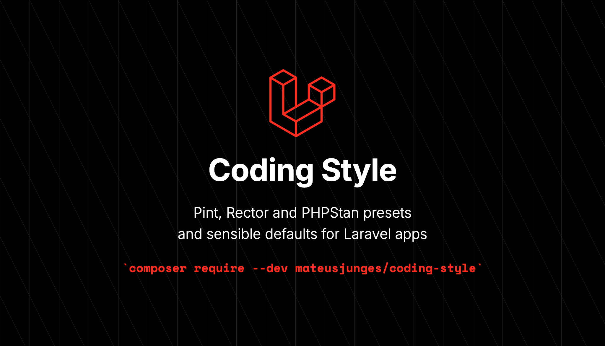

# Coding Style



My coding style for Laravel applications, packaged so a new application gets the same Pint, Rector and PHPStan setup, and the same application defaults, with one command.

The rules live in this package and the application only keeps thin configuration files that point at them. Updating the package updates the coding style of every application that uses it.

## Requirements

PHP 8.5 or newer and Laravel 13.

## Installation

```bash
composer require --dev mateusjunges/coding-style
php artisan coding-style:install
```

Pint, Rector and Larastan are dependencies of this package, so they don't need to be required separately.

The install command publishes these files:

| Tool | Shared configuration | File in the application |
| --- | --- | --- |
| [Pint](https://laravel.com/docs/pint) | `presets/pint.json` | `pint.json` extends the preset |
| [Rector](https://getrector.com) | `Junges\CodingStyle\Rector` | `rector.php` calls `Rector::configure(__DIR__)` |
| [PHPStan](https://phpstan.org) with [Larastan](https://github.com/larastan/larastan) | `presets/phpstan.neon` | `phpstan.neon` includes the preset |
| EditorConfig | | `.editorconfig` |
| GitHub Actions (optional) | | `.github/workflows/coding-style.yml` |
| Application defaults (optional) | | `app/Providers/DefaultsServiceProvider.php` |

It also adds these composer scripts:

| Script | What it does |
| --- | --- |
| `composer cs` | Runs Rector, Pint and PHPStan, fixing what can be fixed |
| `composer cs:check` | Same checks without changing any file (useful in CI) |
| `composer lint` / `composer lint:check` | Pint only |
| `composer rector` / `composer rector:check` | Rector only |
| `composer types:check` | PHPStan only |

The command takes these options:

| Option | Effect |
| --- | --- |
| `--workflow` | Publishes the GitHub Actions workflow without asking |
| `--defaults` | Publishes the defaults service provider without asking |
| `--force` | Replaces existing files and composer scripts without asking |

Without `--force`, the command asks before replacing an existing file and keeps composer scripts that have the same name but a different command. When it runs without interaction (`--no-interaction`), it keeps existing files and only publishes the workflow and the defaults provider when their option is passed.

After installing, run `composer cs` once to bring the existing code in line.

The package also ships [Laravel Boost](https://github.com/laravel/boost) guidelines, so AI agents working on the application know to run `composer cs` and follow the same rules.

## Usage

### Day to day

Run `composer cs` before committing. It runs Rector first, so Pint formats whatever Rector changed, and PHPStan last, on the final code. In CI, run `composer cs:check`, which fails instead of changing files.

Arguments after `--` go to the tool, which is handy for working on part of the application:

```bash
composer lint -- --dirty              # Pint, only files with uncommitted changes
composer lint -- app/Models           # Pint, one directory
composer rector -- app/Models         # Rector, one directory
composer types:check -- app/Models    # PHPStan, one directory
```

### Adopting it on an existing application

The first `composer cs` on an existing application changes many files. Commit that run on its own, without other changes, so it is easy to review. Then add its commit hash to a `.git-blame-ignore-revs` file, which GitHub reads, so `git blame` skips the formatting commit:

```bash
git rev-parse HEAD >> .git-blame-ignore-revs
git config blame.ignoreRevsFile .git-blame-ignore-revs
```

When PHPStan reports more errors than you can fix at once, record them in a baseline and fix them over time. PHPStan then reports only new errors:

```bash
vendor/bin/phpstan analyse --memory-limit=-1 --generate-baseline
```

Include the generated file in `phpstan.neon`:

```neon
includes:
    - vendor/mateusjunges/coding-style/presets/phpstan.neon
    - phpstan-baseline.neon
```

### Ignoring a rule in one place

PHPStan errors can be ignored on a single line with the error identifier, which PHPStan prints next to each error:

```php
// @phpstan-ignore argument.type
$service->handle($payload);
```

Rector rules can be skipped for specific paths in `rector.php`:

```php
return Rector::configure(__DIR__)
    ->withSkip([
        SomeRector::class => [
            __DIR__.'/app/Legacy',
        ],
    ]);
```

Pint has no inline ignore. Exclude files with `notPath` or `exclude` in `pint.json`, or turn the rule off (see [Customizing an application](#customizing-an-application)).

### Editors and AI agents

Editor integrations that run the application's Pint, such as PhpStorm's Laravel Pint support and the Laravel extension for VS Code, read `pint.json`, so formatting on save follows the preset.

If the application uses [Laravel Boost](https://github.com/laravel/boost), run `php artisan boost:update` after installing or updating this package, so its guidelines are added to the instructions your agents read.

## The rules

### Pint

The Pint preset starts from Pint's `laravel` preset and adds these rules:

| Rule | What it enforces |
| --- | --- |
| `declare_strict_types` | Every PHP file declares `strict_types=1` |
| `strict_comparison` | `===` and `!==` instead of `==` and `!=` |
| `final_class` | Every class that is not abstract is `final` (see [Final classes](#final-classes)) |
| `protected_to_private` | `protected` members of a final class become `private`, unless the class extends another class or uses a trait |
| `visibility_required` | Every property, method and constant declares its visibility |
| `self_accessor`, `self_static_accessor` | `self` instead of the class name inside the class, and instead of `static` in final classes |
| `ordered_class_elements` | Members in this order: traits, enum cases, constants, properties, constructor, destructor, magic methods, PHPUnit methods, a model's `casts()`, then abstract, static and instance methods from public to private |
| `ordered_interfaces`, `ordered_traits` | Implemented interfaces and used traits in alphabetical order |
| `global_namespace_import` | Classes, functions and constants are imported with `use` instead of written with a leading backslash |
| `fully_qualified_strict_types` | Fully qualified names in code are shortened to their imported name |
| `date_time_immutable` | `DateTimeImmutable` instead of `DateTime` |
| `mb_str_functions` | Multibyte string functions, such as `mb_strlen()` instead of `strlen()` |
| `modernize_types_casting` | Casts such as `(int) $value` instead of `intval($value)` |
| `array_push` | `$items[] = $item` instead of `array_push($items, $item)` |
| `backtick_to_shell_exec` | `shell_exec()` instead of backticks |
| `no_superfluous_elseif`, `no_useless_else` | No `else` or `elseif` after a branch that returns or throws |
| `no_multiple_statements_per_line` | One statement per line |
| `lowercase_keywords`, `lowercase_static_reference` | Lowercase keywords, and lowercase `self`, `static` and `parent` |

The preset also turns off three rules of the `laravel` preset: `blank_line_after_opening_tag` and `linebreak_after_opening_tag`, so `<?php declare(strict_types=1);` can stay on one line, and `new_with_parentheses`, so `new Foo` is left without parentheses.

Pint skips `tests/TestCase.php`.

### Rector

Rector processes `app`, `bootstrap`, `config`, `database`, `routes` and `tests`, when they exist, and skips `bootstrap/cache` and `database/migrations`. It runs these sets:

| Set | What it does |
| --- | --- |
| Dead code | Removes unused code, such as unused private methods, unreachable statements and redundant casts |
| Code quality | Simplifies expressions, such as combining nested `if` statements and inlining needless variables |
| Coding style | Normalizes small style choices, such as quote escaping, catch variable names (`$exception`) and blank lines around statements |
| Type declarations | Adds parameter, return and property types it can infer |
| Privatization | Narrows visibility and makes members private where it is safe |
| Instanceof | Simplifies `instanceof` checks |
| Early return | Turns nested conditions into early returns |
| PHP version sets | Applies the language upgrades up to the PHP version in the application's `composer.json`, such as `match` expressions, readonly properties and `#[\Override]` on overridden properties |

Rector imports the class names it adds, such as new return types, instead of writing them fully qualified. Names inside docblocks are left as written.

These rules are skipped, because they break Laravel applications:

| Rule | Why it is skipped |
| --- | --- |
| `NullToStrictStringFuncCallArgRector` | Adds unnecessary string casts, because it treats every string as possibly null |
| `ArrayToFirstClassCallableRector` | Rewrites route actions such as `[Controller::class, 'show']` into `(new Controller())->show(...)` |
| `PrivatizeFinalClassPropertyRector` | Laravel reads properties such as `$fillable` and `$signature` from the parent class, so they must stay protected |
| `PrivatizeFinalClassMethodRector` | Laravel calls methods such as `casts()`, accessors and scopes from the parent class, so they must stay protected |
| `PrivatizeLocalGetterToPropertyRector` | Getters are sometimes required, for example by an interface |
| `ClassPropertyAssignToConstructorPromotionRector`, `RemoveDefaultValueFromAssignedPropertyRector` | Move or drop property defaults. `unserialize()` fills missing properties from their declared defaults without calling the constructor, so a queued job or cached object serialized before the property existed ends up with an uninitialized property |
| `SeparateMultiUseImportsRector` | Splits `use HasFactory, Notifiable;` into separate statements and drops the `@use HasFactory<UserFactory>` docblock, which PHPStan needs for the factory's generic type |

Rector caches its results in `storage/framework/cache/rector`, which Laravel already ignores in git.

### PHPStan

PHPStan runs at level 7 with the [Larastan](https://github.com/larastan/larastan) and Carbon extensions, on the `app` directory. It also enables:

| Parameter | What it checks |
| --- | --- |
| `checkOctaneCompatibility` | Code that is unsafe under [Octane](https://laravel.com/docs/octane), such as resolving request specific services in singletons |
| `checkMissingCallableSignature` | `callable` and `Closure` types without a signature, such as `Closure(int): string` |

### EditorConfig

The published `.editorconfig` uses UTF-8, LF line endings, four spaces of indentation (two for YAML files, except Docker Compose files), a final newline, and trims trailing whitespace except in Markdown files.

## Final classes

Every class that is not abstract is made `final` by Pint's `final_class` rule. Pint does not check whether a class has children, so a concrete class that another class extends breaks after formatting. PHPStan reports it (`extends final class`) as part of `composer cs`, as long as both classes are inside the analysed paths.

When a concrete class is extended, move the shared code into an abstract parent and let both concrete classes extend it:

```php
abstract class Report
{
    // Shared behavior.
}

final class SalesReport extends Report
{
}

final class DetailedSalesReport extends Report
{
}
```

Mockery cannot mock final classes either. Bind dependencies you mock to an interface. When a class has to be mocked and an interface is not worth it, add a `@final` tag to its docblock. Pint then leaves the class non-final, so Mockery can mock it:

```php
/**
 * @final
 */
class PaymentGateway
{
}
```

The `@final` tag does not help a class that is extended. PHPStan treats it as final and reports `extends @final class`.

## Application defaults

The defaults provider sets the runtime defaults I use in every application:

| Default | Environments |
| --- | --- |
| `Date::use(CarbonImmutable::class)`, so dates are immutable | All |
| `Model::automaticallyEagerLoadRelationships()` | All |
| `Model::shouldBeStrict()`, which throws on lazy loading, on accessing missing attributes and on silently discarded attributes | All except production |
| `DB::prohibitDestructiveCommands()`, which refuses `migrate:fresh`, `db:wipe` and similar commands | Production |
| Passwords of at least 12 characters with mixed case, letters, numbers and symbols, checked against known leaks | Production |
| `URL::forceHttps()` | Production |
| `Http::preventStrayRequests()` and `Sleep::fake()` | Tests |

The provider is published into the application instead of being loaded from this package. This package is a dev dependency, so it isn't installed in production, where most of these defaults matter. The published file belongs to the application, so change or remove any default there. Changes to the stub in later versions of this package don't reach applications that already published it.

The install command registers the provider in `bootstrap/providers.php`. Laravel's starter kits set some of these defaults in `AppServiceProvider::configureDefaults()`, and the command warns about the calls it finds there so they can be removed.

Strict models is the default most likely to break an existing application. It turns code that reads optional attributes, such as `$model->total ?? 0` on a query that didn't select `total`, into an exception outside production. Run the test suite after publishing the provider.

## GitHub Actions workflow

The optional workflow runs on pushes to `main` and on pull requests. It installs the composer dependencies, prepares the application from `.env.example`, and runs `composer lint:check`, `composer rector:check` and `composer types:check` as separate steps. It uses the PHP version that ran the install command.

## Customizing an application

The application files are regular configuration files, so project specific changes go there.

Pint merges `pint.json` on top of the preset, so a rule can be added or turned off:

```json
{
    "extend": "vendor/mateusjunges/coding-style/presets/pint.json",
    "rules": {
        "strict_comparison": false
    }
}
```

Lists are merged by position rather than appended. Setting `notPath` in the application replaces the preset's `tests/TestCase.php` entry, so repeat it when you set your own.

`Rector::configure()` returns Rector's configuration builder, so it can be chained:

```php
return Rector::configure(__DIR__)
    ->withSkip([
        SomeRector::class,
    ]);
```

`withPaths()` replaces the default paths, while `withSkip()` adds to the preset's skip list.

PHPStan parameters set in `phpstan.neon` override the preset, for example a different `level` or more `paths`.

## Updating

```bash
composer update mateusjunges/coding-style
composer cs
```

The Pint, Rector and PHPStan rules come from the package, so updating it applies new rules on the next `composer cs`. Review the diff before committing it.

The published files are not updated. To get a newer version of the defaults provider or the workflow, run the install command again with `--defaults` or `--workflow` and confirm the replacement. This overwrites changes you made to those files.

## Migrating an existing application

When the application already has its own Pint, Rector and PHPStan setup, run the install command with `--force` to replace the configuration files and the composer scripts with the same names. Then remove what the old setup leaves behind, such as a separate Rector installation (for example `tools/rector`), composer scripts that call it, and its cache directory (for example `cache/rector`). The preset caches Rector results in `storage/framework/cache/rector`, so an old cache directory is no longer excluded and Pint formats the stale files in it.

Run `composer cs` and the test suite afterwards, and review the diff before committing it.

## Notes

The PHPStan preset includes the Larastan and Carbon extensions itself. If the application uses `phpstan/extension-installer`, PHPStan reports those files as included twice. Remove the extension installer, or replace the preset include with your own parameters.

Pint only extends configuration files that live inside the project. Installing this package from a symlinked [path repository](https://getcomposer.org/doc/05-repositories.md#path) makes the preset resolve outside the project and Pint refuses it. Use `"options": {"symlink": false}` when testing local changes.

## Developing the package

```bash
composer test
```

This runs PHPStan, Pint, Rector, type coverage and the Pest suite. The package is checked with its own presets.
